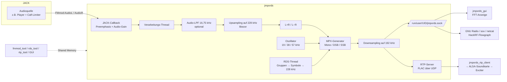

# JMPXRDS – Technische Dokumentation

Diese Dokumentation beschreibt Aufbau, Installation und Betrieb von JMPXRDS auf
Basis des aktuellen Quellcodes (Version 0.5 laut `configure.ac`). Sie ergänzt
die kurze Übersicht in der [README](../README.md).

## Inhalt

1. [Überblick](#1-überblick)
2. [Architektur und Signalfluss](#2-architektur-und-signalfluss)
3. [Quellcode-Übersicht](#3-quellcode-übersicht)
4. [Abhängigkeiten und Build](#4-abhängigkeiten-und-build)
5. [Betrieb](#5-betrieb)
6. [Kommandozeilen-Werkzeuge](#6-kommandozeilen-werkzeuge)
7. [Grafische Oberfläche](#7-grafische-oberfläche)
8. [Ausgänge: FIFO und RTP](#8-ausgänge-fifo-und-rtp)
9. [RTP-Client](#9-rtp-client)
10. [GNU-Radio-Empfänger zum Debuggen](#10-gnu-radio-empfänger-zum-debuggen)
11. [Ausgabe über HackRF / osmo-sdr](#11-ausgabe-über-hackrf--osmo-sdr)
12. [RDS-Encoder im Detail](#12-rds-encoder-im-detail)
13. [DSP-Details](#13-dsp-details)
14. [Interne Schnittstellen (Shared Memory, Signale)](#14-interne-schnittstellen-shared-memory-signale)
15. [Tests und Coverage](#15-tests-und-coverage)
16. [Bekannte Einschränkungen und Auffälligkeiten im Code](#16-bekannte-einschränkungen-und-auffälligkeiten-im-code)

---

## 1. Überblick

JMPXRDS ist ein in C geschriebener Software-Generator für das FM-Multiplexsignal
(MPX) eines UKW-Stereo-Senders. Er nimmt ein Stereo-Audiosignal über
[JACK](https://jackaudio.org/) entgegen und erzeugt daraus das komplette
Basisband-MPX-Signal:

| Anteil              | Frequenz            | Inhalt                                           |
|---------------------|---------------------|--------------------------------------------------|
| Summensignal L+R    | bis ca. 16,75 kHz   | Mono-kompatibles Audio                          |
| Pilotton            | 19 kHz              | Stereo-Kennung, Phasenreferenz für den Empfänger |
| Differenzsignal L−R | 23 – 53 kHz (DSB) bzw. 23 – 38 kHz (SSB) | AM-moduliert auf 38 kHz (2 × Pilot)  |
| RDS                 | 57 kHz ± 2,4 kHz    | Biphase-codierte RDS-Daten (3 × Pilot)           |

Das Ergebnis ist ein **reelles Float32-Signal mit 192 kHz Abtastrate**. JMPXRDS
erzeugt *kein* HF-Signal; die eigentliche Frequenzmodulation übernimmt ein
nachgeschalteter UKW-Exciter (gespeist über eine 192-kHz-Soundkarte) oder ein
SDR wie der HackRF (siehe [Abschnitt 11](#11-ausgabe-über-hackrf--osmo-sdr)).

Funktionen im Überblick:

* Stereo-Codierung wahlweise als DSB-SC (Standard), SSB (Hartley oder
  Filter-Methode) oder Mono
* FM-Preemphasis 50 µs (Europa) / 75 µs (USA) oder abgeschaltet
* Audio-Tiefpass (FFT-FIR) zum Schutz des Pilottons
* RDS-Encoder mit PI, PS, PTY, PTYN, RT, TP, TA, MS, DI, ECC, LIC und CT (Uhrzeit)
* Dynamisches PS und dynamischer RadioText aus Textdateien
* Ausgabe über eine lokale FIFO und einen eingebauten RTP-Server (FLAC-komprimiert)
* Steuerung zur Laufzeit über GTK3-GUI oder Kommandozeilen-Werkzeuge

## 2. Architektur und Signalfluss

JMPXRDS besteht aus einem Hintergrundprozess (`jmpxrds`) und mehreren
Steuerprogrammen. Die Kommunikation läuft über POSIX Shared Memory, für das
Hinzufügen/Entfernen von RTP-Empfängern zusätzlich über Signale.



Ablauf pro JACK-Periode:

1. **JACK-Callback** (`fmmod_process_cb` in `fmmod.c`): Liest die Ports
   `FMmod:AudioL` und `FMmod:AudioR`, wendet die Preemphasis an, multipliziert
   mit dem Audio-Gain, misst die Eingangsspitzen und weckt den
   Verarbeitungs-Thread.
2. **Verarbeitungs-Thread** (`fmmod_process`): optionaler Audio-Tiefpass,
   Upsampling auf die Oszillator-Rate von 228 kHz, Bildung von L+R und L−R.
3. **MPX-Generator**: je nach Stereo-Modus wird pro Sample
   `L+R + Pilot + moduliertes L−R + RDS` berechnet und mit dem MPX-Gain skaliert.
4. **Downsampling** auf 192 kHz (libsoxr, hohe Qualität).
5. **Ausgabe**: Schreiben in die FIFO und Übergabe an den RTP-Server. Die ersten
   Perioden, in denen der Resampler noch nicht die volle Sample-Anzahl liefert,
   werden verworfen.

Der RDS-Encoder läuft in einem eigenen Thread mit Doppelpuffer: Während eine
fertige, auf 228 kHz hochgerechnete RDS-Gruppe ausgespielt wird, berechnet der
Thread bereits die nächste.

Warum 228 kHz intern? 228 kHz ist das kleinste gemeinsame Vielfache von 38 kHz
und 57 kHz (6 × 38 kHz = 4 × 57 kHz). Damit liegen Hilfsträger und RDS-Träger
auf ganzzahligen Abtastrastern (Kommentar in `oscilator.h`).

## 3. Quellcode-Übersicht

### Hauptprogramm `jmpxrds`

| Datei | Aufgabe |
|-------|---------|
| `main.c` | Einstiegspunkt. Setzt SCHED_FIFO-Priorität 99, initialisiert den Modulator, installiert Signal-Handler, meldet `READY=1` an systemd (falls verfügbar) und läuft, bis JACK stoppt oder ein Signal eintrifft. |
| `fmmod.c` / `fmmod.h` | Kern: JACK-Client „FMmod", Puffer, Verarbeitungs-Thread, die vier MPX-Generatoren, FIFO-Ausgabe, Steuerkanal `FMMOD_CTL_SHM`. |
| `oscilator.c` / `.h` | Phasenkontinuierlicher Sinus-/Kosinus-Oszillator bei 228 kHz. Liefert phasenstarre 19-, 38- und 57-kHz-Samples aus einer gemeinsamen Phase. |
| `filters.c` / `.h` | FFT-basierter FIR-Tiefpass (Overlap-Discard), IIR-Preemphasis-Filter, Hilbert-Transformator für den Hartley-SSB-Modulator. |
| `resampler.c` / `.h` | Wrapper um libsoxr: Audio-Upsampling (L/R in eigenen Threads), RDS-Upsampling 47,5 kHz → 228 kHz, MPX-Downsampling 228 kHz → 192 kHz. Läuft JACK bereits mit 228 kHz, wird das Audio-Upsampling übersprungen. |
| `rds_encoder.c` / `.h` | RDS-Encoder: Gruppenbildung, Prüfwörter, differentielle Codierung, Biphase-Symbolformung per Lookup-Tabelle, Gruppen-Scheduler, Steuerkanal `RDS_ENC_SHM`. |
| `rtp_server.c` / `.h` | Eingebauter RTP-Server auf GStreamer-Basis (appsrc → FLAC → rtpgstpay → rtpbin → UDP), Steuerkanal `RTP_SRV_SHM`. Per `--without-rtp-server` abschaltbar. |
| `utils.c` / `.h` | Shared-Memory-Hilfsfunktionen und farbige Konsolenausgabe. |

### Steuerprogramme

| Datei | Programm | Aufgabe |
|-------|----------|---------|
| `fmmod_tool.c` | `fmmod_tool` | Pegel, Stereo-Modus, Audio-LPF und Preemphasis setzen bzw. abfragen |
| `rds_tool.c`, `rds_config.c`, `rds_dynpsrt.c` | `rds_tool` | RDS-Felder setzen, dynamisches PS/RT |
| `rtp_tool.c` | `rtp_tool` | RTP-Empfänger hinzufügen/entfernen, Statistik |
| `gui/*.c` | `jmpxrds_gui` | GTK3-Oberfläche mit drei Reitern (MPX Generator, RDS Encoder, RTP Server) und FFT-Spektrumanzeige |

### Weitere Verzeichnisse

| Pfad | Inhalt |
|------|--------|
| `rtp_client/` | Eigenständiger RTP-Client für die Senderseite inkl. systemd-Unit und Environment-Datei |
| `grc_receiver/` | GNU-Radio-3.10-Flowgraph (`.grc` + generiertes `.py`) zum Dekodieren und Prüfen des MPX-Signals inklusive RDS |
| `gui/images/` | Logos für die GUI, werden nach `$(datarootdir)/jmpxrds_gui/` installiert |
| `test-run.sh` | Integrationstest mit `jackd` (Dummy-Treiber) |
| `.travis.yml`, `sonar-project.properties` | CI- und SonarCloud-Konfiguration aus dem Upstream-Projekt |

## 4. Abhängigkeiten und Build

### Benötigte Bibliotheken

| Bibliothek | Wofür | Pflicht |
|------------|-------|---------|
| libjack (JACK2 empfohlen) | Audio-Eingang | ja |
| libsoxr | Resampling | ja |
| libfftw3f | FFT-Filter, Hilbert-Transformator, GUI-Spektrum | ja |
| libm, librt, pthreads | Mathematik, Shared Memory | ja |
| libsystemd | `sd_notify` beim Start | optional (sonst nur Warnung) |
| GStreamer ≥ 1.0 (core, base, controller, app) + `gstreamer1.0-plugins-good` | RTP-Server (FLAC, RTP) | ja, außer bei `--without-rtp-server` |
| GTK+ ≥ 3.16, libepoxy ≥ 1.3 | GUI | ja, außer bei `--without-gtk` |

Unter Debian/Ubuntu entspricht das etwa:

```sh
sudo apt install build-essential autoconf automake pkg-config \
    libjack-jackd2-dev jackd2 libsoxr-dev libfftw3-dev \
    libgstreamer1.0-dev libgstreamer-plugins-base1.0-dev gstreamer1.0-plugins-good \
    libgtk-3-dev libepoxy-dev libsystemd-dev
```

### Kompilieren

```sh
autoreconf -ivf
./configure            # Optionen siehe unten
make
sudo make install
```

`configure`-Optionen:

| Option | Wirkung |
|--------|---------|
| `--without-rtp-server` | RTP-Server und `rtp_tool` werden nicht gebaut, GStreamer wird nicht benötigt |
| `--without-gtk` | GUI wird nicht gebaut (für Headless-Systeme) |
| `--enable-debug` | Debug-Ausgaben, `-g --coverage`, Backtrace bei Absturz, `make test` führt `test-run.sh` aus |

Installierte Programme: `jmpxrds`, `fmmod_tool`, `rds_tool`, optional
`rtp_tool` und `jmpxrds_gui`.

Der RTP-Client wird separat gebaut:

```sh
cd rtp_client
make                 # benötigt gstreamer-1.0 und gstreamer-rtp-1.0
sudo make install    # Binary, /etc/default/…env und systemd-Unit
sudo make enable
```

## 5. Betrieb

### 5.1 Starten

1. JACK starten, idealerweise mit Echtzeit-Priorität. Jede Abtastrate
   funktioniert, getestet sind 48, 96 und 192 kHz bei Periodengrößen von
   512–4096 Samples:

   ```sh
   jackd -R -d alsa -r 48000 -p 1024
   ```

2. JMPXRDS starten (ohne Argumente; JACK wird nicht automatisch gestartet):

   ```sh
   jmpxrds
   ```

   `jmpxrds` versucht, sich SCHED_FIFO-Priorität 99 zu geben. Ohne passende
   Rechte erscheint nur eine Warnung. Läuft bereits eine Instanz (JACK-Client
   „FMmod" vorhanden), bricht der Start ab.

3. Audioquelle mit den Eingangsports verbinden:

   ```sh
   jack_connect <quelle>:out_L FMmod:AudioL
   jack_connect <quelle>:out_R FMmod:AudioR
   ```

4. RDS einschalten (ist nach dem Start **deaktiviert**) und Felder setzen:

   ```sh
   rds_tool -e -pi 0xD3C1 -ps "MEINRADIO" -pty 10 -rt "Willkommen bei Meinradio"
   ```

5. Ausgabe nutzen: GUI, FIFO-Leser oder RTP-Empfänger (siehe Abschnitte 7–11).

### 5.2 Beenden

`SIGINT`, `SIGTERM`, `SIGHUP` oder `SIGQUIT` beenden JMPXRDS sauber; dabei
werden die Shared-Memory-Segmente und die FIFO entfernt. Wird JACK beendet,
beendet sich JMPXRDS ebenfalls. Bei `SIGSEGV`/`SIGABRT` werden die
Shared-Memory-Segmente entfernt und der Prozess hart beendet.

Bleiben nach einem Absturz Segmente zurück, schlägt der nächste Start fehl.
Dann helfen:

```sh
rm -f /dev/shm/FMMOD_CTL_SHM /dev/shm/RDS_ENC_SHM /dev/shm/RTP_SRV_SHM
rm -f /run/user/$(id -u)/jmpxrds.sock
```

### 5.3 Pegel und Hub

Das Ausgangssignal ist ein Float-Signal; welcher Amplitude welcher Frequenzhub
entspricht, hängt vom Exciter bzw. von der nachfolgenden FM-Modulation ab.
Laut Upstream bleiben die Standardwerte zusammen mit einem sauber
eingestellten Kompressor/Limiter (empfohlen: Calf Studio Gear) innerhalb der
erlaubten 75 kHz Hub. Die aktuellen Spitzenwerte lassen sich mit
`fmmod_tool -g` oder in der GUI ablesen.

## 6. Kommandozeilen-Werkzeuge

Alle Werkzeuge verbinden sich über Shared Memory mit einem laufenden
`jmpxrds`. Läuft dieser nicht, melden sie „Unable to communicate …". Mehrere
Optionen können in einem Aufruf kombiniert werden.

### 6.1 `fmmod_tool` – Modulator

| Option | Wert | Bedeutung | Standard (laut Code) |
|--------|------|-----------|----------------------|
| `-g` | – | Aktuelle Einstellungen und Spitzenpegel anzeigen | |
| `-a` | 0–999 % | Audio-Gain | 45 % |
| `-m` | 0–999 % | MPX-Gesamtgain | 75 % |
| `-p` | 0–999 % | Pilotton-Gain | 4 % |
| `-r` | 0–999 % | RDS-Gain | 3 % |
| `-c` | 0–999 % | Gain des Stereo-Hilfsträgers (L−R) | 80 % |
| `-s` | 0–3 | Stereo-Modus: 0 = DSB-SC, 1 = SSB Hartley, 2 = SSB Filter, 3 = Mono | 0 |
| `-f` | 0/1 | Audio-Tiefpass (16,75 kHz) aus/an | 1 |
| `-e` | 0–2 | Preemphasis: 0 = 50 µs, 1 = 75 µs, 2 = aus | 0 |

> Hinweis: Der Hilfetext von `fmmod_tool` nennt abweichende Standardwerte
> (40/100/8/2/100 %). Maßgeblich sind die Werte aus `fmmod_init_ctl()` in
> `fmmod.c`, die oben aufgeführt sind.

Beispiel:

```sh
fmmod_tool -a 45 -m 80 -p 4 -r 3 -c 60 -s 0 -f 1 -e 0
fmmod_tool -g
```

Zu den Stereo-Modi:

* **DSB-SC** (Standard): klassisches Doppelseitenband mit unterdrücktem
  Träger bei 38 kHz. Beste Kompatibilität.
* **SSB Hartley**: L−R wird per Hilbert-Transformator um 90° gedreht und mit
  Sinus/Kosinus gemischt, sodass nur das untere Seitenband übrig bleibt.
* **SSB Filter**: L+R und moduliertes L−R werden gemeinsam durch einen
  FFT-Tiefpass bei 38 kHz geschickt, der das obere Seitenband entfernt (so
  bleiben beide Anteile zeitlich synchron).
* **Mono**: nur L+R und RDS, kein Pilotton.

Der Autor merkt im Code an, dass SSB zwar besseren RDS-Empfang und Reichweite
brachte, viele Empfänger aber damit schlechter zurechtkommen. DSB bleibt die
Empfehlung.

### 6.2 `rds_tool` – RDS-Encoder

Optionen werden mit einfachem Bindestrich angegeben (`getopt_long_only`).

| Option | Wert | Bedeutung |
|--------|------|-----------|
| `-g` | – | Aktuelle RDS-Konfiguration anzeigen |
| `-e` / `-d` | – | Encoder einschalten / ausschalten (Standard: aus) |
| `-pi` | hex | Programme Identification, z. B. `0xD3C1` |
| `-ps` | Text, max. 8 Zeichen | Programme Service Name |
| `-pty` | 0–31 | Programme Type |
| `-ptyn` | Text, max. 8 Zeichen | Programme Type Name |
| `-rt` | Text, max. 64 Zeichen | RadioText (Wechsel setzt das A/B-Flag um, Empfänger löschen ihren Puffer) |
| `-ecc` | hex | Extended Country Code (z. B. `0xE0` für Deutschland) |
| `-lic` | hex | Language Identification Code |
| `-tp` | 0/1 | Traffic Programme |
| `-ta` | 0/1 | Traffic Announcement |
| `-ms` | 0/1 | Music (1, Standard) / Speech (0) |
| `-di` | hex 0–F | Decoder Identification: Bit 0 Stereo, Bit 1 Kunstkopf, Bit 2 komprimiert, Bit 3 dynamischer PTY. Standard `0x9` (Stereo + dyn. PTY) |
| `-dps` | Datei | Dynamisches PS aus Datei |
| `-drt` | Datei | Dynamischer RadioText aus Datei |
| `-dt` | Sekunden | Laufzeitbegrenzung für `-dps`/`-drt` |

Beispiel:

```sh
rds_tool -e -pi 0x1001 -pty 0 -ptyn test -ecc 0xe1 -lic 0x70 -tp 0 -ta 0 -ms 1 -di 0x9 -rt "Hallo Welt"
```

**Dynamisches PS (`-dps`)**: `rds_tool` überwacht die Datei per inotify. Ihr
Inhalt (max. 64 Zeichen, Leerraum an Anfang/Ende wird entfernt) wird in
8-Zeichen-Blöcken nacheinander als PS gesendet, alle 3 Sekunden ein Block.
Nach jedem kompletten Durchlauf erscheint wieder der ursprüngliche
Sendername. Das RDS-Forum rät von dynamischem PS ab; die Funktion existiert,
weil Sender danach gefragt haben.

**Dynamischer RadioText (`-drt`)**: Bis zu 3 Zeilen der Datei (je max. 64
Zeichen) werden reihum als RT gesendet. Ist die Datei leer, wird der vorher
gesetzte RT verwendet.

In beiden Fällen läuft `rds_tool` im Vordergrund weiter, bis es per
Ctrl+C/`SIGTERM` oder nach Ablauf von `-dt` beendet wird. Typischer Einsatz:
Die Playout-Software schreibt den aktuellen Titel in die Datei.

```sh
rds_tool -drt /var/run/nowplaying.txt &
```

### 6.3 `rtp_tool` – RTP-Server

| Option | Wert | Bedeutung |
|--------|------|-----------|
| `-g` | – | Senderate RTP/RTCP in KB/s und Liste der Empfänger |
| `-a` | IPv4-Adresse | Empfänger hinzufügen |
| `-r` | IPv4-Adresse | Empfänger entfernen |

Maximal 64 Empfänger. Hinzufügen/Entfernen erfolgt über `SIGUSR1`/`SIGUSR2`
an den `jmpxrds`-Prozess, nicht über Shared Memory.

## 7. Grafische Oberfläche

`jmpxrds_gui` (GTK3) bietet drei Reiter:

* **MPX Generator**: Stereo-Modus, Audio-LPF, Preemphasis, Pegelanzeigen für
  Audio-Eingang und MPX-Ausgang, Schieberegler für alle Gains sowie eine
  FFT-Spektrumanzeige des MPX-Signals (OpenGL über GtkGLArea/libepoxy,
  mit „Smooth Hold" und „Max Hold").
* **RDS Encoder**: alle RDS-Felder inkl. Länder- und Sprachauswahl (ECC/LIC aus
  Tabellen in `gui/rds_codes.c`), PTY-Liste, DI-Flags, Ein/Aus-Schalter und
  Dateiauswahl für dynamisches PS/RT.
* **RTP Server**: Liste der Empfänger-IP-Adressen und Übertragungsstatistik.

Die Spektrumanzeige liest aus der FIFO `/run/user/<UID>/jmpxrds.sock`. Da eine
FIFO nur einen sinnvollen Leser hat, sollte parallel kein anderer Prozess
(z. B. ein HackRF-Flowgraph) daraus lesen.

## 8. Ausgänge: FIFO und RTP

### 8.1 Lokale FIFO

* Pfad: `/run/user/<UID>/jmpxrds.sock` (eine Named Pipe, kein Unix-Socket)
* Format: rohe 32-Bit-Float-Samples, Little Endian, mono, **192 000 Hz**
* Schreiben erfolgt nicht-blockierend: Liest niemand, werden die Daten
  verworfen. Schließt der Leser, öffnet JMPXRDS die FIFO bei der nächsten
  Periode erneut.

Beispiele:

```sh
# Spektrum bzw. Aufnahme mit sox
sox -t raw -r 192000 -e floating-point -b 32 -c 1 /run/user/$(id -u)/jmpxrds.sock mpx.wav

# Direkt auf eine 192-kHz-Soundkarte ausgeben (Exciter-Eingang)
sox -t raw -r 192000 -e floating-point -b 32 -c 1 /run/user/$(id -u)/jmpxrds.sock -t alsa hw:0
```

### 8.2 RTP-Server

Für Studio-Sender-Strecken überträgt JMPXRDS das MPX-Signal per RTP. Die
GStreamer-Pipeline ist:

```
appsrc (F32LE, 192 kHz, mono) → audioconvert → S16LE → flacenc
    → rtpgstpay → rtpbin (AVPF, Retransmission per rtprtxsend) → multiudpsink
```

| Port | Richtung | Inhalt |
|------|----------|--------|
| 5000/UDP | Server → Client | RTP (FLAC-Payload) |
| 5001/UDP | Server → Client | RTCP |
| 5002/UDP | Client → Server | RTCP-Rückkanal (u. a. NACKs für Retransmission) |

Die Basisport-Nummer 5000 ist in `fmmod.c` fest eingetragen. Die FLAC-Codierung
erfolgt mit 16 Bit, was die Datenrate gegenüber rohem Float deutlich senkt.

## 9. RTP-Client

`rtp_client/jmpxrds_rtp_client` empfängt den RTP-Strom am Senderstandort und
gibt ihn über ALSA auf eine Soundkarte aus, an der der Exciter hängt
(getestet mit Raspberry Pi + HiFiBerry und Odroid + HiFi Shield).

| Option | Standard | Bedeutung |
|--------|----------|-----------|
| `-h`, `--remote-host` | – (Pflicht) | IPv4-Adresse des JMPXRDS-Rechners (für den RTCP-Rückkanal) |
| `-l`, `--latency` | 200 | Jitterbuffer in ms |
| `-d`, `--device` | `default` | ALSA-Ausgabegerät, z. B. `hw:CARD=ODROIDDAC,DEV=0` |
| `-p`, `--remote-base-port` | 5000 | wird derzeit nicht ausgewertet (siehe Abschnitt 16) |
| `-o`, `--stdout_output` | 0 | `1` gibt Float32-Rohdaten auf stdout aus statt auf ALSA |

Der Client lauscht fest auf 5000 (RTP) und 5001 (RTCP) und sendet RTCP an
Port 5002 des Servers. Mit `SIGUSR1` gibt er RTP-Statistiken aus. FLAC-Packet-
Loss-Concealment ist aktiviert.

Ablauf:

```sh
# Auf dem Studio-Rechner
rtp_tool -a 192.168.1.50

# Auf dem Sender-Rechner (192.168.1.50)
jmpxrds_rtp_client -h 192.168.1.10 -d hw:CARD=sndrpihifiberry,DEV=0
```

Für den Dauerbetrieb liegen `jmpxrds_rtp_client.service` (SCHED_FIFO 99,
automatischer Neustart) und `jmpxrds_rtp_client.env` bei. Achtung: Die
Environment-Datei und die Unit verwenden derzeit die Option `-r`, die der
Client nicht kennt (siehe Abschnitt 16); vor dem Einsatz `-r $REMOTE_RTCP_PORT`
aus `ExecStart` entfernen.

## 10. GNU-Radio-Empfänger zum Debuggen

`grc_receiver/jmpxrds_rx.grc` (GNU Radio 3.10, benötigt das Modul `gr-rds`)
liest das MPX-Signal direkt aus der FIFO und zeigt:

* Spektrum und Wasserfall des MPX-Signals
* demodulierten Stereo-Ton (Pilot-PLL, L−R-Demodulation, 50-µs-Deemphasis,
  Ausgabe auf die Soundkarte mit 48 kHz)
* dekodierte RDS-Daten (57-kHz-Mischung, Costas-Loop, Taktrückgewinnung,
  differentielle Decodierung, `rds.decoder`/`rds.parser`)

Der Pfad `/var/run/user/1000/jmpxrds.sock` ist im Flowgraph fest eingetragen
und muss bei einer anderen Benutzer-ID angepasst werden.

```sh
python3 grc_receiver/jmpxrds_rx.py
```

## 11. Ausgabe über HackRF / osmo-sdr

JMPXRDS selbst enthält keinen SDR-Ausgang; es liefert das MPX-Basisband. Um
damit einen HackRF (oder ein anderes von gr-osmosdr unterstütztes Gerät) zu
betreiben, muss das MPX-Signal noch frequenzmoduliert, auf die Abtastrate des
SDR gebracht und an `osmosdr.sink` übergeben werden. Das geht am einfachsten
mit GNU Radio, das die FIFO als Quelle liest:

```
FIFO (float, 192 kHz)
  → frequency_modulator_fc (Hub 75 kHz)
  → rational_resampler_ccc (×32/3 → 2,048 MS/s)
  → osmosdr.sink("hackrf=0")
```

Minimalbeispiel (ungetestete Vorlage, Werte anpassen):

```python
#!/usr/bin/env python3
import math, os
from gnuradio import gr, blocks, analog, filter
import osmosdr

MPX_RATE = 192_000
SDR_RATE = MPX_RATE * 32 // 3          # 2,048 MS/s (HackRF: mind. 2 MS/s)
MAX_DEV  = 75e3                        # Hub bei MPX-Amplitude 1.0
FREQ     = 100.0e6                     # Sendefrequenz

class mpx_to_hackrf(gr.top_block):
    def __init__(self):
        gr.top_block.__init__(self, "JMPXRDS -> HackRF")
        fifo = f"/run/user/{os.getuid()}/jmpxrds.sock"
        src = blocks.file_source(gr.sizeof_float, fifo, False)
        fm  = analog.frequency_modulator_fc(2 * math.pi * MAX_DEV / MPX_RATE)
        rs  = filter.rational_resampler_ccc(interpolation=32, decimation=3)
        sdr = osmosdr.sink(args="numchan=1 hackrf=0")
        sdr.set_sample_rate(SDR_RATE)
        sdr.set_center_freq(FREQ)
        sdr.set_gain(0)          # HF-Verstärker (0 oder 14 dB)
        sdr.set_if_gain(20)      # TX-VGA 0–47 dB
        sdr.set_bandwidth(1.75e6)
        self.connect(src, fm, rs, sdr)

if __name__ == "__main__":
    tb = mpx_to_hackrf()
    tb.start()
    input("Senden läuft – Enter zum Beenden\n")
    tb.stop(); tb.wait()
```

Hinweise:

* Die Skalierung „Amplitude 1.0 = 75 kHz Hub" ist eine Annahme. Mit
  `fmmod_tool -g` den MPX-Spitzenwert prüfen und `MAX_DEV` bzw. den MPX-Gain
  so wählen, dass der Spitzenhub 75 kHz nicht überschreitet.
* Die FIFO hat nur einen Leser: GUI-Spektrumanzeige und HackRF-Flowgraph nicht
  gleichzeitig betreiben. Alternativ kann der HackRF-Rechner den RTP-Strom mit
  `jmpxrds_rtp_client -o 1` empfangen und per Pipe einlesen.
* Ein Sender ohne Ausgangsfilter erzeugt Oberwellen. Für jeden Betrieb
  außerhalb eines abgeschirmten Messaufbaus ist eine Frequenzzuteilung
  erforderlich (in Deutschland durch die Bundesnetzagentur).

## 12. RDS-Encoder im Detail

### Signalerzeugung

* Bitrate 1187,5 bit/s (57 kHz / 48)
* Interne RDS-Abtastrate 47 500 Hz, 40 Samples pro Symbol
* Jedes Bit wird differentiell codiert und als vorberechnete, gefilterte
  Biphase-Wellenform aus einer Tabelle ausgegeben (Ansatz nach Robert
  Langmeiers RdsEnc)
* Eine Gruppe = 4 Blöcke à 26 Bit (16 Bit Information + 10 Bit Prüfwort mit
  Offset A/B/C/C'/D), Dauer ca. 87,6 ms, also rund 12 Gruppen pro Sekunde
* Die Gruppen-Wellenform wird auf 228 kHz hochgerechnet und mit dem
  phasenstarren 57-kHz-Träger multipliziert

### Unterstützte Gruppen

| Gruppe | Inhalt |
|--------|--------|
| 0A / 0B | PS, TA, MS, DI (0A nur, wenn AF gesetzt ist, sonst 0B) |
| 1A | ECC und LIC (abwechselnd, Variant Code 0 bzw. 3) |
| 2A | RadioText, 64 Zeichen, mit A/B-Flag |
| 4A | Uhrzeit und Datum (CT), aus der Systemzeit inkl. Zeitzonen-Offset |
| 10A | PTYN |
| 15B | Fast Basic Tuning, wenn kein PS gesetzt ist |

### Scheduler (pro Sekunde, ca. 12 Gruppen)

1. 4 × Gruppe 0 (bzw. 15B ohne PS) → vollständiges PS und DI einmal pro Sekunde
2. 1 × Gruppe 1A, falls ECC oder LIC gesetzt
3. bis zu 2 × Gruppe 10A, falls PTYN gesetzt
4. restliche Plätze: Gruppe 2A (RadioText), falls gesetzt
5. einmal pro Minute: Gruppe 4A (CT)

### Standardwerte nach dem Start

Encoder aus, PI 0x0000, PTY 0, MS = Music, DI = 0x9 (Stereo + dynamischer PTY),
alle Texte leer.

## 13. DSP-Details

| Baustein | Umsetzung |
|----------|-----------|
| Preemphasis | IIR 1. Ordnung (bilinear transformiert), läuft mit JACK-Abtastrate im JACK-Callback, getrennte Koeffizienten für 50 µs und 75 µs; bei Umschaltung wird der Filterzustand zurückgesetzt |
| Audio-Tiefpass | FFT-FIR, Grenzfrequenz 16 750 Hz, Overlap-Discard mit Faktor 3 (erzeugt eine feste Verzögerung) |
| Upsampling Audio | libsoxr, Quick-Qualität, L und R parallel in eigenen JACK-Threads |
| Upsampling RDS | libsoxr, 47,5 kHz → 228 kHz |
| Oszillator | eine gemeinsame Phase bei 228 kHz; 19/38/57 kHz entstehen durch Multiplikation der Phase mit der Frequenz und sind dadurch phasenstarr |
| SSB Hartley | FFT-basierter Hilbert-Transformator (90°-Drehung von L−R) plus Kosinus-Oszillator, der auf die Phase des Haupt-Oszillators gezogen wird |
| SSB Filter | FFT-Tiefpass bei 38 kHz auf das kombinierte Signal |
| Downsampling MPX | libsoxr, High-Quality, 228 kHz → 192 kHz |

Die Threads (Verarbeitung, Resampler L/R, RDS) werden über
`jack_client_create_thread` mit JACK-Echtzeitpriorität erzeugt.

## 14. Interne Schnittstellen (Shared Memory, Signale)

| Segment | Struktur | Erzeugt von | Genutzt von |
|---------|----------|-------------|-------------|
| `/FMMOD_CTL_SHM` | `struct fmmod_control` (`fmmod.h`) | `jmpxrds` | `fmmod_tool`, GUI |
| `/RDS_ENC_SHM` | `struct rds_encoder_state` (`rds_encoder.h`) | `jmpxrds` | `rds_tool`, GUI |
| `/RTP_SRV_SHM` | `struct rtp_server_control` (`rtp_server.h`) | `jmpxrds` | `rtp_tool`, GUI |

Die Steuerprogramme schreiben direkt in diese Strukturen; der
Verarbeitungs-Thread liest die Werte bei jeder Periode. Alle Programme müssen
deshalb aus demselben Quellstand gebaut sein.

Signale an `jmpxrds`:

| Signal | Wirkung |
|--------|---------|
| `SIGUSR1` + `sival_int` (IPv4) | RTP-Empfänger hinzufügen |
| `SIGUSR2` + `sival_int` (IPv4) | RTP-Empfänger entfernen |
| `SIGINT`, `SIGTERM`, `SIGHUP`, `SIGQUIT` | sauber beenden (`SIGQUIT` schreibt im Debug-Build zusätzlich Coverage-Daten) |
| `SIGPIPE` | ignoriert |

## 15. Tests und Coverage

`test-run.sh` ist ein Integrationstest. Er startet `jackd` mit dem
Dummy-Treiber, dann `jmpxrds`, und ruft `rds_tool`, `fmmod_tool` und
`rtp_tool` mit verschiedenen Parametern auf. Ein Test gilt als bestanden, wenn
das Werkzeug erfolgreich endet und `jmpxrds` danach noch läuft.

```sh
./configure --enable-debug
make
make test               # schneller Lauf (48 kHz / 1024) inkl. gcov-Auswertung
./test-run.sh full      # alle Kombinationen 48/96/192 kHz × 512–4096 Samples
```

Achtung: Das Skript beendet laufende `jackd`- und `jmpxrds`-Prozesse per
`killall`.

## 16. Bekannte Einschränkungen und Auffälligkeiten im Code

Folgende Punkte sind bei der Analyse des Quellcodes aufgefallen. Sie sind hier
dokumentiert, aber (noch) nicht behoben:

1. **Kein JACK-Ausgangsport**: `fmmod.h` deklariert `outMPX`, der Port wird
   aber nie registriert. Das MPX-Signal steht nur über FIFO und RTP zur
   Verfügung.
2. **Alternative Frequenzen (AF) praktisch nicht nutzbar**: Es gibt keinen
   Setter für `af_data`/`af_set`. Außerdem überschreibt `rds_generate_group_0()`
   in Gruppe 0A den AF-Block direkt wieder mit `temp_infoword`.
3. **RadioText-Steuerzeichen**: Die Bedingung in `rds_set_rt()` ist durch die
   `||`-Verknüpfung immer wahr, daher werden auch die erlaubten Zeichen CR, LF,
   End-of-Headline und Soft-Hyphen entfernt.
4. **Dynamischer RT wechselt alle 3 statt 10 Sekunden**: Der Consumer-Thread
   nutzt `DYNPS_DELAY_SECS` statt `DYNRT_DELAY_SECS`.
5. **RTP-Client-Optionen**: `jmpxrds_rtp_client.env` und die systemd-Unit
   übergeben `-r`, das der Client nicht kennt; der Start schlägt dadurch fehl.
   Die Option `-p/--remote-base-port` wird eingelesen, aber nicht verwendet.
6. **RTCP-Bind-Port**: In `rtp_server.c` wird `bind-port` für den RTCP-Ausgang
   auf `rtpsink` statt auf `rtcpsink` gesetzt (vermutlich Tippfehler).
7. **`fmmod_tool`-Hilfetext** nennt andere Standardwerte als der Code (siehe
   Abschnitt 6.1).
8. **`rds_tool -di`** meldet „MS set" statt „DI set".
9. **`rds_tool` mit `-dps`/`-drt`** wartet in einer leeren Schleife
   (`while(active);`) und belegt dabei einen CPU-Kern voll.
10. **GRC-Empfänger** hat den FIFO-Pfad für UID 1000 fest eingetragen.
11. **CI**: `.travis.yml` bezieht sich auf travis-ci.org, das nicht mehr
    betrieben wird; die Badges in der README zeigen auf das Upstream-Projekt
    UoC-Radio.
12. **Nur IPv4** für RTP-Empfänger.
